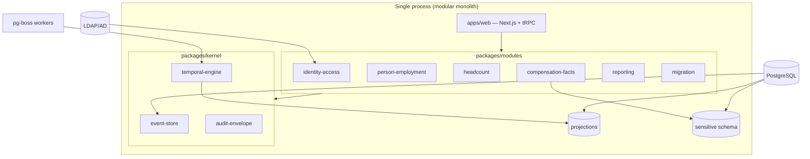
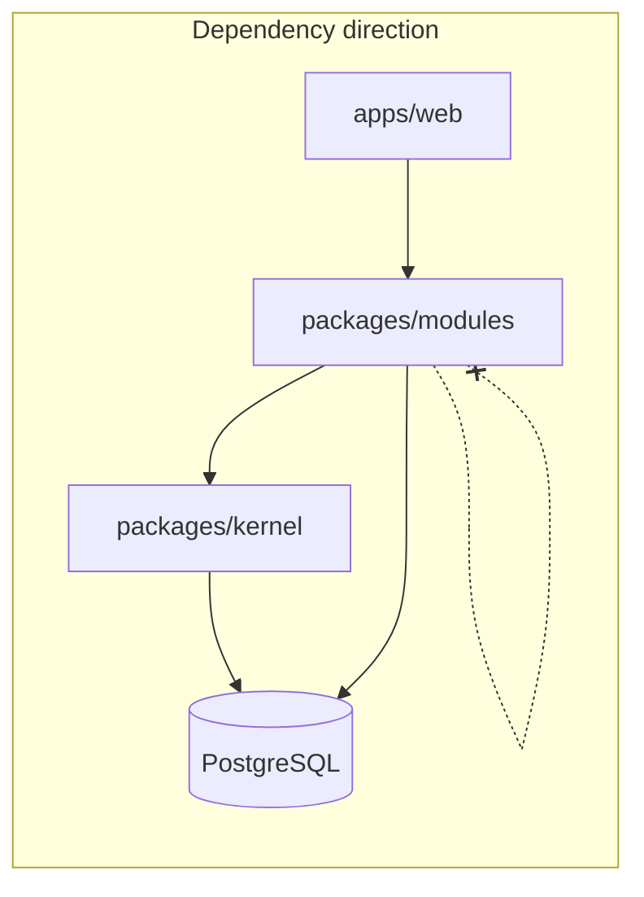
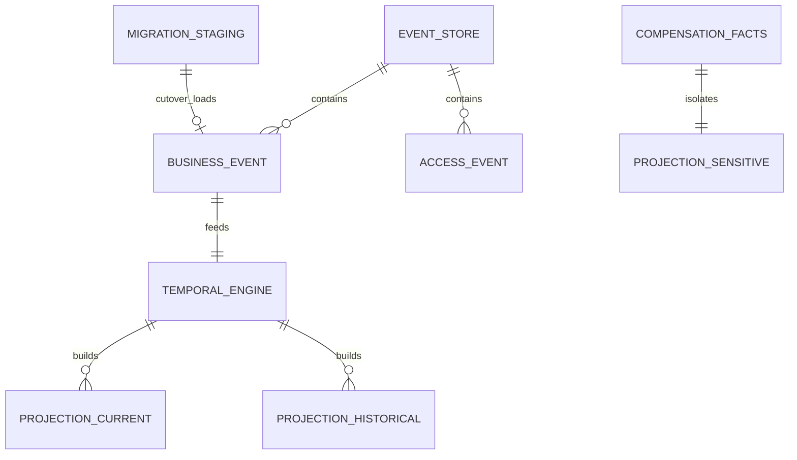

# Architecture Spine — Divan HRIS

## Design Paradigm

**Modular monolith with event-sourcing-lite:** one deployable process, one PostgreSQL database, explicit domain modules, and a shared kernel that owns append-only events, temporal resolution, and the audit envelope. Current and historical workforce state are **derived projections**, never authoritative sources of truth.



| Layer | Responsibility |
| --- | --- |
| **Kernel** | Append-only store, effective-date engine, audit envelope — no domain UI |
| **Modules** | Bounded contexts; call kernel APIs; no cross-module direct projection access |
| **Projections** | Read models rebuilt from business events; Prisma-managed except kernel store |
| **apps/web** | Persian RTL desktop UI; tRPC procedures import modules/kernel only |

## Invariants & Rules

### AD-1 — Modular Monolith Deployment Unit [ADOPTED]

- **Binds:** all MVP capabilities; NFR-13 scale envelope; on-prem ops model
- **Prevents:** microservice ops overhead, undifferentiated blob monolith, multi-tenant complexity in MVP
- **Rule:** Exactly one application process and one PostgreSQL database in MVP. Domain boundaries are enforced by package/module dependency rules, not separate services. Multi-tenant and service split are out of scope until a future spine revision.

### AD-2 — Append-Only Event Store and Derived Projections [ADOPTED]

- **Binds:** FR-14..FR-18, FR-25..FR-27, FR-42; UJ-1, UJ-2
- **Prevents:** CRUD-as-source-of-truth, silent history rewrite, incompatible current vs historical state
- **Rule:** Authoritative workforce mutations are persisted as typed, append-only **business events** in the kernel event-store. Current profile, headcount counts, and as-of views are **projections** rebuilt by the temporal-engine. Projections are never updated in place as source of truth; corrections use Cancel / Reverse / Correction chains on events.

### AD-3 — Shared Kernel and Module Boundaries [ADOPTED]

- **Binds:** FR-22, FR-30, FR-31 semantics; headcount atomic transfer; cross-module recalculation
- **Prevents:** Headcount coupling through Personnel Events module ownership; ORM bypass of sensitive data boundaries
- **Rule:** `packages/kernel` owns **event-store**, **temporal-engine**, and **audit-envelope**. Domain modules MUST NOT own the event log. Modules communicate in-process via published module APIs only — no direct reads of another module's internal tables. **Compensation facts** (including military-service compensation) live in a **separate DB schema** with a dedicated repository interface; application code outside `compensation-facts` MUST NOT import that repository or schema.

### AD-4 — Migration Staging and Atomic Cutover [ADOPTED]

- **Binds:** FR-37..FR-40, FR-39 Baseline boundary; AR-MIGRATION rollback/reconciliation
- **Prevents:** pre-approval pollution of production event-store; append-only violations on migration rollback
- **Rule:** `migration` module writes to a **separate staging schema** with dry-run, pause, validate, and approval lifecycle. Production event-store receives Baseline events only via an **atomic cutover** operation after independent approval. Rollback before cutover = drop staging with **zero production trace**. The first production event per Person is the approved Baseline event; `source=migration` is metadata for audit only, not the cutover mechanism. Post-cutover the migration module MAY remain disabled.

### AD-5 — Hybrid Authorization and Unified Audit Log [ADOPTED]

- **Binds:** FR-1..FR-4, FR-46..FR-49, FR-51; AR-ACCESS, AR-AUDIT
- **Prevents:** scattered authz checks, unaudited sensitive reads, split correlation between business and access evidence
- **Rule:** **Identity-access** module owns authentication and **coarse** authorization (role, Organizational Scope, delegation, acting/interim). **Kernel audit-envelope** owns **fine-grained** category checks (sensitive fields, bulk thresholds, break-glass) and MUST write an **access event** atomically with every sensitive read/write decision — default-deny enforced at the envelope. One append-only store holds all events with `event_class ∈ {business, access}`: business events feed temporal-engine and projections; access events are query/report only and never mutate derived state. Physical table partitioning MAY be applied later without architectural change.

### AD-6 — Projection Refresh Policy and T3 Stack Guardrails [ADOPTED]

- **Binds:** UJ-1 reservation/atomic transfer; FR-18 heavy recalculation; FR-43 RTL web; implementation consistency
- **Prevents:** headcount race on async finalize; Prisma convenience eroding module boundaries; unaudited direct DB access from UI layer
- **Rule:** **Critical mutations** (finalization affecting current headcount, reservations, atomic transfers) MUST refresh affected projections **synchronously in the same database transaction** as event append. **Heavy historical recalculation** (e.g., deep backdate) MAY run **async** via **pg-boss** on the same PostgreSQL with a visible `recalculation_pending` UI state. **T3 stack is adopted** [ADOPTED]: Next.js + tRPC + Prisma + pg-boss monorepo; organization has no .NET/Java mandate. **Prisma for projections only**; **raw SQL / `$transaction` for kernel event-store**; **ESLint `no-restricted-imports`** blocks direct `@prisma/client` in `apps/web`; tRPC context exposes **envelope-wrapped repositories** only. AR-NFR still pins Node/PostgreSQL versions and ops envelope — not stack re-selection.

### AD-7 — Governed Application Configuration [ADOPTED 2026-07-31]

- **Binds:** FR-60 configuration administration; FR-42 and FR-55 change evidence; FR-45 degraded state
- **Prevents:** the same parameter existing as a literal in one module and an environment variable in another; silent configuration drift; a UI setting quietly widening a security boundary
- **Rule:** Governed application parameters live in a **typed registry** (label, description, type, unit, range or allowlist, default, editability, owning domain) with a **database-backed store** read through a **single resolver with cached reads**. Modules MUST NOT read raw environment variables or literals for registered parameters. An unavailable or invalid value **fails closed to the registered code default** and raises the FR-45 degraded state. Every change is attributable through the existing audit envelope and reversible to default. **Security, authorization, audit-integrity, and identity posture parameters remain deployment-managed and read-only in the UI**, surfaced with their real change path. No AD-1…AD-6 change. Authorized by `sprint-change-proposal-2026-07-31.md`.



## Consistency Conventions

| Concern | Convention |
| --- | --- |
| Naming — events | PascalCase type names; past-tense verbs (`TransferRecorded`, `PromotionRecorded` taxonomy-only in MVP) |
| Naming — modules/packages | kebab-case directories; one bounded context per package under `packages/modules/` |
| IDs | Stable server-generated UUIDs for events and aggregates; Personnel Code is domain identifier, not PK |
| Dates | **Effective Date** (business) vs registration/finalization timestamps (system); Jalali UX with reliable timezone handling — calendar rules deferred to AR-TEMPORAL |
| Event envelope | All stored events carry `event_class`, actor, timestamp, correlation id; business events add effective-date and aggregate refs |
| Errors | Domain errors typed and Persian-user-facing at API boundary; no silent authorization fallthrough |
| Auth | Every sensitive read/write path enters through audit-envelope; coarse scope from identity-access passed as context |
| Logging | Technical logs redacted per FR-45; no LDAP secrets or unnecessary HR content |
| Sensitive data | Compensation schema isolated; sensitive export requires separate permission via envelope |
| Async jobs | pg-boss queue names prefixed by domain (`temporal.recalculate`, etc.); idempotent handlers |
| Configuration | Registered parameters read only through the AD-7 resolver; no direct `process.env` or literal reads for a registered parameter; invalid or unavailable values fail closed to the registered default |

## Stack

| Name | Version | Notes |
| --- | --- | --- |
| Node.js | 22.x LTS | Adopted (T3); AR-NFR pins exact version and hardening |
| TypeScript | 5.x | Monorepo (pnpm workspaces or equivalent) |
| Next.js | 16.2.x | App Router; Persian RTL desktop SPA |
| tRPC | 11.x | API layer; no direct Prisma in routers |
| Prisma | 7.8.x | Projections and module read models only |
| PostgreSQL | 17.10+ | Default assumption; AR-NFR may specify alternate RDBMS |
| pg-boss | 12.26.x | Async recalculation; same DB, no extra infra |
| LDAP/AD | org-provided | Via identity-access module; no password storage in app |

## Structural Seed

```text
divan/
  apps/
    web/                    # Next.js UI + tRPC entry; imports modules/kernel only
  packages/
    kernel/
      event-store/          # append-only; raw SQL
      temporal-engine/      # effective-date resolution, recalc trigger
      audit-envelope/       # fine-grained authz + access events
    modules/
      identity-access/
      person-employment/
      headcount/
      compensation-facts/   # separate schema + repo
      reporting/
      migration/            # staging lifecycle; disabled post-cutover optional
    db/
      prisma/               # projection schemas
      sql/                  # kernel migrations (event-store, staging)
  workers/                  # pg-boss worker bootstrap (may co-reside with web process)
```



## Capability → Architecture Map

| Capability / Area | Lives in | Governed by |
| --- | --- | --- |
| Enterprise auth (FR-1) | identity-access | AD-5, AR-IDENTITY |
| Least privilege & scope (FR-2, FR-47) | identity-access + audit-envelope | AD-5, AR-ACCESS |
| Sensitive/export permissions (FR-3) | audit-envelope + compensation-facts | AD-3, AD-5, AR-DATA |
| Person / Employment (FR-5..FR-7) | person-employment | AD-2, AD-3 |
| Compensation facts (FR-8, FR-24) | compensation-facts | AD-3, AD-5 |
| Organization / reference (FR-9..FR-13) | person-employment | AD-2 |
| Personnel Events lifecycle (FR-14..FR-21) | person-employment → kernel | AD-2, AD-3, AR-TEMPORAL |
| Headcount governance (FR-28..FR-32) | headcount + temporal-engine | AD-2, AD-3, AD-6, AR-HEADCOUNT |
| Search / profile / timeline (FR-33..FR-34) | reporting + projections | AD-5 |
| Dashboard & reports (FR-35..FR-36) | reporting | AD-2, AD-5 |
| Migration / Baseline (FR-37..FR-40) | migration | AD-4, AR-MIGRATION |
| Export (FR-41) | reporting via audit-envelope | AD-5 |
| Audit & break-glass (FR-42, FR-46, FR-51) | audit-envelope | AD-5, AR-AUDIT |
| Persian RTL / Jalali UX (FR-43..FR-44) | apps/web | AD-6, UX DESIGN.md |
| Ops health (FR-45) | apps/web + infra | infra-security-brief |
| Cross-cutting FR-46..FR-56 | kernel + modules | AD-5, Launch Artifacts |
| Promotion outcome (deferred workflow) | event taxonomy only | AD-2 (`PromotionRecorded`) |

## Deferred

| Item | Reason |
| --- | --- |
| Exact OS, hardware, backup RPO/RTO, availability targets | Owned by AR-NFR; infra-security-brief supplies inputs |
| Alternate RDBMS (SQL Server / Oracle) | PostgreSQL assumed; repository layer must stay swappable |
| Alternate application stack (.NET / Java) | Not required; T3 adopted per org confirmation 2026-07-15 |
| Separate audit database | Single store with `event_class` sufficient at MVP scale; partition if volume demands |
| Promotion workflow module | MVP records outcome event only; addendum §14.1 hypothesis |
| Multi-tenant / multi-process split | PRD deferred; spine unchanged until PRD revision |
| Workstation / floor-map domain | PRD deferred; event taxonomy may extend later |
| Hash-chain tamper evidence (NFR-10) | Implement if AR-AUDIT / AR-NFR mandates; schema-ready append-only store |
| Saved personal report filters | PRD deferred |
| General workflow engine | Non-goal |
