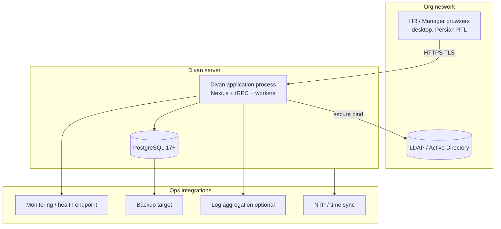

# Divan HRIS — Infrastructure & Security Brief

**Audience:** Infrastructure / Operations, Information Security, Legal/Privacy (AR-NFR, AR-IDENTITY, AR-AUDIT owners)  
**Purpose:** Inputs to complete Launch Artifacts — not a substitute for AR-NFR approval  
**Architecture reference:** `ARCHITECTURE-SPINE.md` (2026-07-15)  
**Status:** Draft for AR-NFR population

---

## 1. Deployment Topology (MVP)

Single-organization, on-premise, initial population ~500 people. MVP targets a **single-server deployment** to minimize operational burden for the customer Ops team.

| Component | MVP assumption | AR-NFR must confirm |
| --- | --- | --- |
| Application | One Node.js process (web + pg-boss workers co-located) | OS, CPU/RAM, hardened baseline |
| Database | PostgreSQL co-located on same host or dedicated DB VM | Version, storage, HA choice |
| Reverse proxy / TLS | Customer-provided (IIS/nginx/Apache) terminating TLS | Certificate lifecycle |
| Identity | Existing LDAP/AD; app stores no passwords | Bind account, attributes, MFA policy |
| Time | NTP-synchronized; critical for effective-dating & audit | Stratum, timezone authority |

---

## 2. Network & Integration Points

| Direction | Protocol | Port (typical) | Notes |
| --- | --- | --- | --- |
| Users → Divan | HTTPS | 443 (via proxy) | Desktop web only; no mobile MVP |
| Divan → LDAP/AD | LDAPS | 636 | Read/authenticate; secure bind per AR-IDENTITY |
| Divan → PostgreSQL | TCP | 5432 | Localhost or private VLAN |
| Ops → health | HTTPS | 443 | Redacted health per FR-45; no HR content |
| Backup agent → PG | org-specific | — | Physical/logical backup per AR-NFR RPO/RTO |

**Outbound:** MVP requires LDAP and NTP only. No SaaS dependencies, telemetry, or automatic external updates unless explicitly approved in AR-NFR.

---

## 3. Security Architecture Summary

Aligned with spine **AD-5** and PRD FR-46..FR-56.

| Control | Implementation direction | Launch Artifact |
| --- | --- | --- |
| Authentication | LDAP/AD; one internal account per human | AR-IDENTITY |
| Coarse authorization | Role, Organizational Scope, delegation | AR-ACCESS |
| Fine-grained / sensitive | Kernel audit-envelope; default-deny | AR-ACCESS, AR-DATA |
| Audit — business changes | Append-only `event_class=business` | AR-AUDIT |
| Audit — access / export | Append-only `event_class=access`; atomic with check | AR-AUDIT, FR-49 |
| Break-glass | Time-bound, approved, reviewed; envelope-logged | AR-ACCESS, AR-AUDIT |
| Sensitive compensation | Separate DB schema + repo; no casual ORM access | AR-DATA |
| Tamper evidence | Append-only store; hash-chain if AR-AUDIT/NFR-10 requires | AR-AUDIT |
| Non-production data | Production HR data prohibited by default in lower envs | AR-DATA, AR-MIGRATION |
| Session / revocation | Finite revocation objective | AR-IDENTITY, AR-ACCESS |

---

## 4. Data Retention, Backup & Recovery

Architecture provides **one PostgreSQL database** with logical separation (schemas: kernel/events, projections, compensation sensitive, migration staging). Physical partitioning of access vs business events MAY be added without app redeploy.

| Topic | Architecture expectation | AR-NFR / AR-DATA must define |
| --- | --- | --- |
| Backup scope | Full PG + WAL/archiving as customer standard | RPO, RTO, frequency, encryption |
| Restore test | Evidence before production (UJ-5 / FR-45) | Acceptance procedure |
| Retention — events | Append-only; disposal rules per category | AR-DATA lifecycle classes |
| Retention — access log | Queryable; may outlive projection snapshots | AR-AUDIT |
| Legal hold | Must block disposal without breaking append-only audit | AR-DATA |
| Migration staging | Ephemeral; dropped on rollback or post-cutover archive policy | AR-MIGRATION |

---

## 5. Assumptions Requiring Infra Confirmation

These are **architecture defaults**, not approved facts. AR-NFR approval is blocking for production baseline.

| # | Assumption | Risk if rejected |
| --- | --- | --- |
| A1 | **Node.js 22 LTS** (T3 stack adopted) | Org confirmed no .NET/Java mandate (2026-07-15). AR-NFR pins version/hardening only |
| A2 | **PostgreSQL 17+** permitted as RDBMS | Repository porting effort; event-store SQL rewrite |
| A3 | Single-server MVP acceptable for ~500 users / AR-NFR concurrency | Scale-out design needed before build |
| A4 | pg-boss job tables acceptable in same PostgreSQL | Separate queue infra required |
| A5 | LDAP/AD is sole identity source for launch | Alternate IdP integration scope |
| A6 | Jalali calendar + reliable timezone (Asia/Tehran or org-defined) on server | Temporal correctness risk — AR-TEMPORAL |

---

## 6. AR-NFR Checklist — Suggested Values to Supply

Use this table when drafting AR-NFR. Values below are **prompts**, not decisions.

| AR-NFR topic | Questions for infra/security |
| --- | --- |
| OS & hardening | Windows Server vs Linux? CIS baseline? Antivirus exceptions? |
| Hardware | vCPU, RAM, disk (GB), IOPS for PG + 5yr event growth |
| PostgreSQL | Major version, HA (single / patroni / other), connection limits |
| Node runtime | Approved version, service manager (systemd / Windows Service) |
| TLS | Internal CA vs public; cipher policy |
| Availability | Service window, planned maintenance, dependency degradation |
| RPO / RTO | Backup frequency; max data loss; max downtime |
| Performance profile | Concurrent users; dataset size; page/search/dashboard targets (NFR-2) |
| Monitoring | Health metrics, alert routes, log retention |
| Security assurance | Patch SLA, pen-test scope, incident response |
| Non-production | Masking rules for copies of prod data |
| Jurisdiction | Records/legal obligations affecting retention |

---

## 7. Operational Runbook Hooks (MVP)

| Scenario | Expected behavior |
| --- | --- |
| LDAP unavailable | Authenticate fails closed; clear Persian message (FR-1) |
| DB unavailable | Full outage; health endpoint red |
| Stuck recalculation | pg-boss retry; UI shows `recalculation_pending` |
| Pre-cutover migration failure | Drop staging; production untouched (AD-4) |
| Emergency HR access | Break-glass via AR-ACCESS; envelope audit mandatory |
| Restore from backup | Replay append-only store; projections rebuildable from events |

---

## 8. Document Cross-References

| Artifact | Relationship |
| --- | --- |
| `ARCHITECTURE-SPINE.md` | Authoritative build invariants (AD-1..AD-6) |
| PRD §8.1, FR-46..FR-56 | Product security requirements |
| AR-ACCESS | Permission matrix → envelope rules |
| AR-AUDIT | Access event schema, retention, tamper evidence |
| AR-IDENTITY | LDAP topology, session, break-glass account |
| AR-DATA | Sensitive categories including compensation |
| AR-MIGRATION | Staging, segregation of duties, cutover evidence |
| AR-NFR | **This brief feeds AR-NFR drafting** |

---

*Generated as companion to architecture spine coaching run 2026-07-15. T3 stack confirmed 2026-07-15 — no org mandate for .NET/Java. Update when AR-NFR is approved.*
